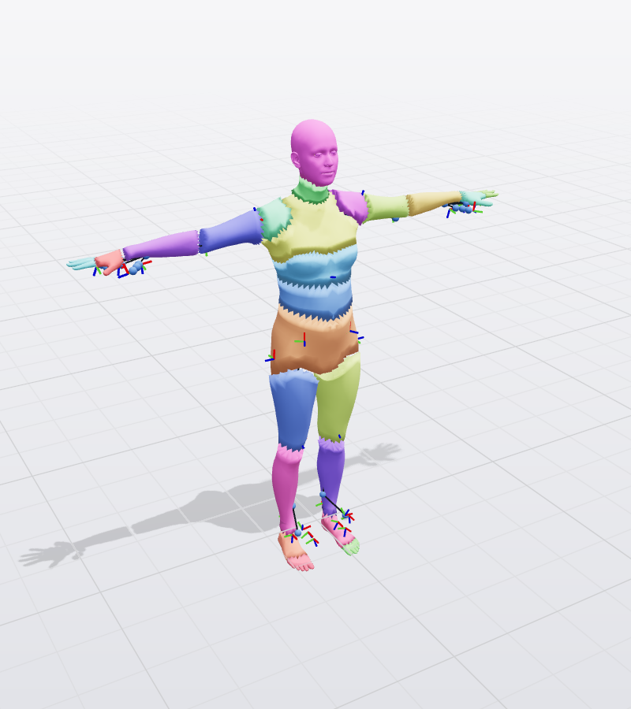

# BetterHuman

Parametric human body models (SMPL, SMPL-H, SMPL-X, MANO, FLAME, MHR and SOMA) as batched, differentiable
[BetterRobot](https://github.com/rihat99/BetterRobot) models: bake a subject's shape once, then pose whole batches
with BetterRobot's kinematics, dynamics, optimisers and browser viewer.



Documentation: [docs/](docs/index.md), served as a site by `uv run mkdocs serve`.

## Install with [uv](https://docs.astral.sh/uv/)

```bash
git clone https://github.com/rihat99/BetterHuman && cd BetterHuman
uv sync --extra studio  # the package, the pinned BetterRobot, the browser viewer and HumanStudio, and the dev group
```

## Pose four SMPL bodies at once

This needs no licensed weights: it reads the random-weight SMPL archive the tests use. Real bodies need yours
([Supply the weights](#supply-the-weights)).

```python
import torch
import better_robot as br
import better_human as bh

human = bh.load("smpl", "tests/support/random_weights/smpl_random.npz")
subject = human.bake(betas=torch.zeros(10))  # the shape, baked once into a BetterRobot Model with part masses
q = subject.model.q_neutral.expand(4, -1).clone()  # (4, nq): a free-flyer root and 23 ball joints
q[:, 1] = torch.linspace(0.0, 1.5, 4)  # lift the root by 0 to 1.5 m (y up)
state = subject.forward(q)  # one batched forward-kinematics query for the four poses
print(tuple(state.vertices.shape), tuple(state.joint_translations.shape))
print(br.center_of_mass(subject.model, state.kinematics)[:, 1])  # BetterRobot dynamics on the baked masses
```
```output
(4, 6890, 3) (4, 24, 3)
tensor([0.1660, 0.6660, 1.1660, 1.6660])
```

The first line is the skinned mesh and the joint positions of the four poses; the second, the height in metres of
the body's centre of mass, which rises with the root. The archive holds random numbers in SMPL's layout, so the body
looks like noise, but every call, name and shape is the one the licensed SMPL file gives. `subject.model` is a plain
BetterRobot `Model`, and `state.kinematics` its `KinematicState`: Jacobians, dynamics and solvers apply unchanged.

## Supply the weights

BetterHuman never downloads or ships body-model weights. Register at the [SMPL](https://smpl.is.tue.mpg.de/) or
[SMPL-X](https://smpl-x.is.tue.mpg.de/) site and download the files there; take MHR and SOMA from their authors'
releases. Put the files in one folder in the layout of [Load a family](docs/guides/load-a-family.md) and name it:

```bash
export BETTERHUMAN_MODELS_DIR=/path/to/models
```

`bh.load("smpl")` then reads `$BETTERHUMAN_MODELS_DIR/smpl/SMPL_NEUTRAL.npz`; an explicit path, as above, always
wins. [Convert weights](docs/guides/convert-weights.md) turns the SMPL Chumpy pickle and the MHR and SOMA releases
into the files the loaders read.

| family | loader | identity groups | stream groups |
|---|---|---|---|
| SMPL | `bh.load("smpl")` | `betas` | |
| SMPL-H | `bh.load("smplh")` | `betas` | |
| SMPL-X | `bh.load("smplx")`; `bh.families.smplx(hands=, face=)` | `betas` | `expression` |
| MANO | `bh.load("mano")` | `betas` | |
| FLAME | `bh.load("flame")` | `betas` | `expression` |
| MHR | `bh.load("mhr")` (level of detail 1; `bh.families.mhr(lod=)`) | `identity`, `proportions` | `expression` |
| SOMA | `bh.load("soma")` (mid level of detail) | `shape` | |

Identity groups go to `bake`, stream groups to `forward` (`subject.forward(q, streams={"expression": ...})`).

## Where next

- [Your first human](docs/getting-started/first-human.md): load, bake, pose and view a body, one step at a time.
- [Architecture](docs/concepts/architecture.md): the packages, and how a family becomes a BetterRobot model.
- [Scope](docs/contracts/scope.md): what BetterHuman computes, what it leaves out, and the bar for a new feature.
- [Examples](examples/): `uv run python examples/01_smpl_shape_pose.py` opens SMPL with shape sliders in the
  browser viewer; 02 to 04 show partial SMPL-X, a reaching IK solve and MHR. They read your weights; 01 to 03 take
  `--model-path` to read a random-weight archive instead, and each takes `--check` to build its scene and exit.
- [Use the studio](docs/guides/use-the-studio.md): HumanStudio paints parts and places contact frames.
- Upgrading from 0.1: [Migrating to 0.2.0](docs/reference/migration-0.2.0.md) maps every public name that 0.2.0
  renames or removes, and the [changelog](docs/reference/changelog.md) says what changed.

## Development

```bash
uv run pytest tests/contract -q -m "not slow and not cuda and not licensed"  # fast tier
uv run pytest tests -q -m "not cuda and not licensed"                        # full tier, no weights needed
uv run ruff check . && uv run ruff format --check .
uv run mkdocs build --strict
```

[Run the tests](docs/guides/run-the-tests.md) gives every tier, its time and what it needs, and [Run the
benchmarks](docs/guides/run-the-benchmarks.md) the counter gate and the timing sweep. Parity tests against each
family's upstream code (`tests/parity/`) are the numerical oracle.

## License

Code: Apache-2.0 ([LICENSE](LICENSE)). Body-model weights and data derived from them keep their own licences.
