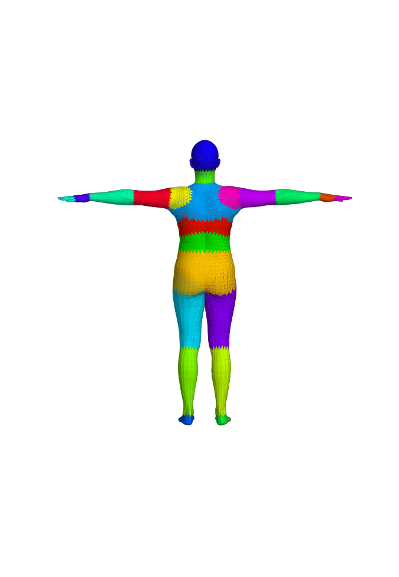
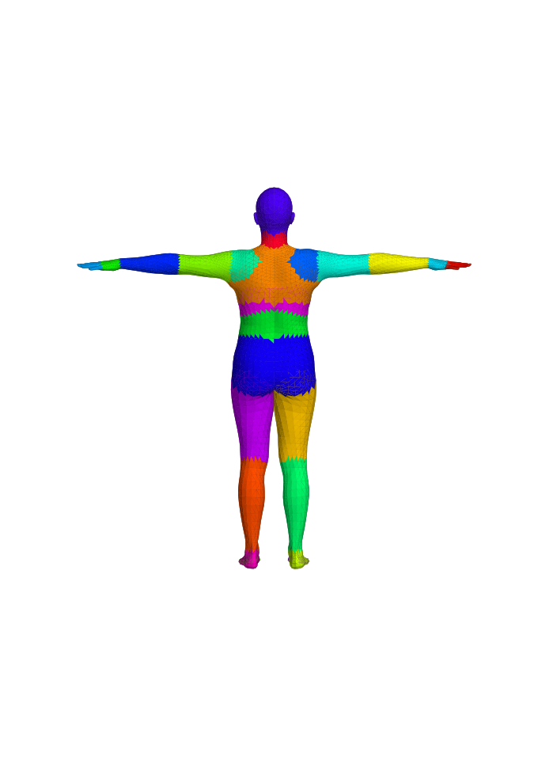
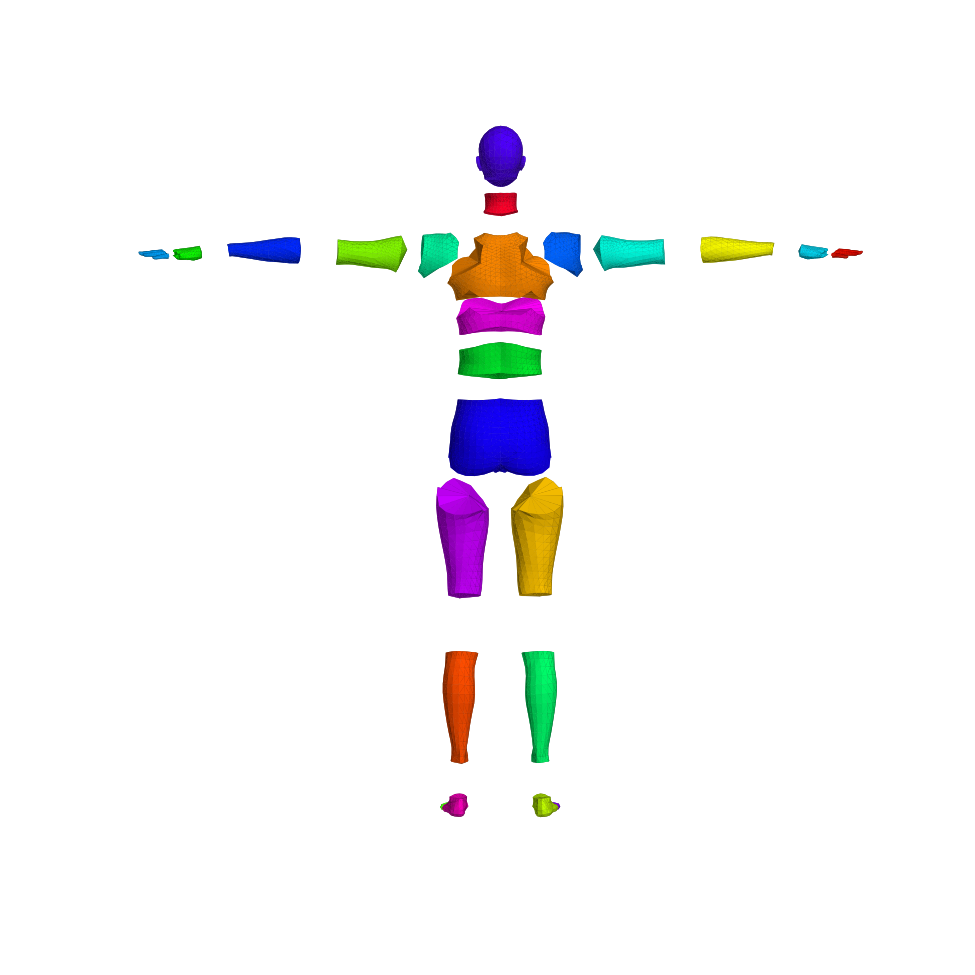
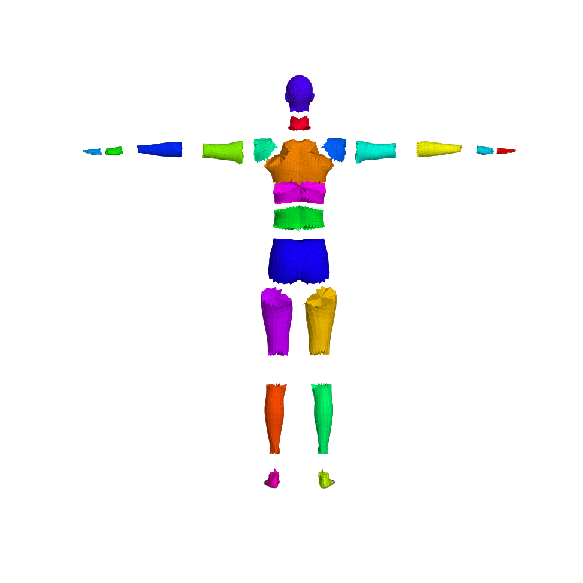
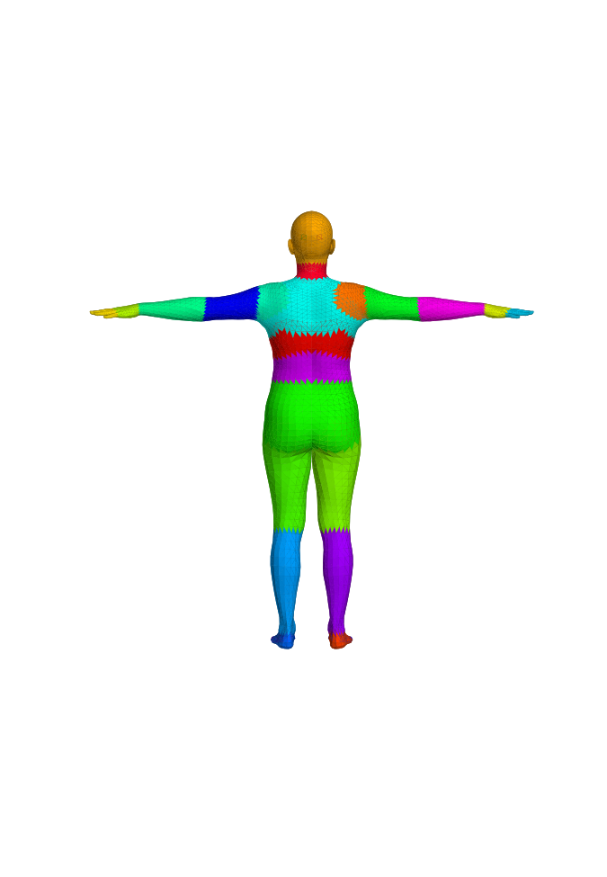
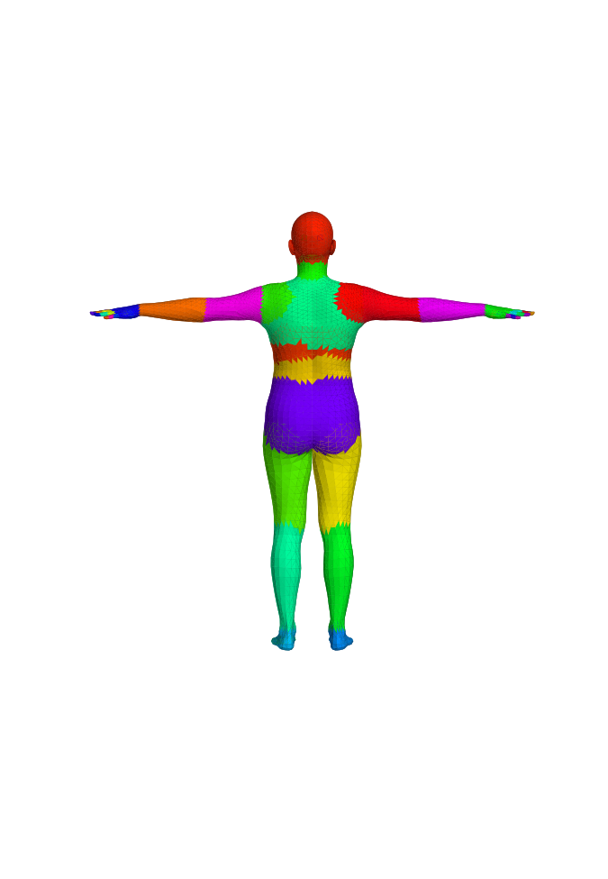
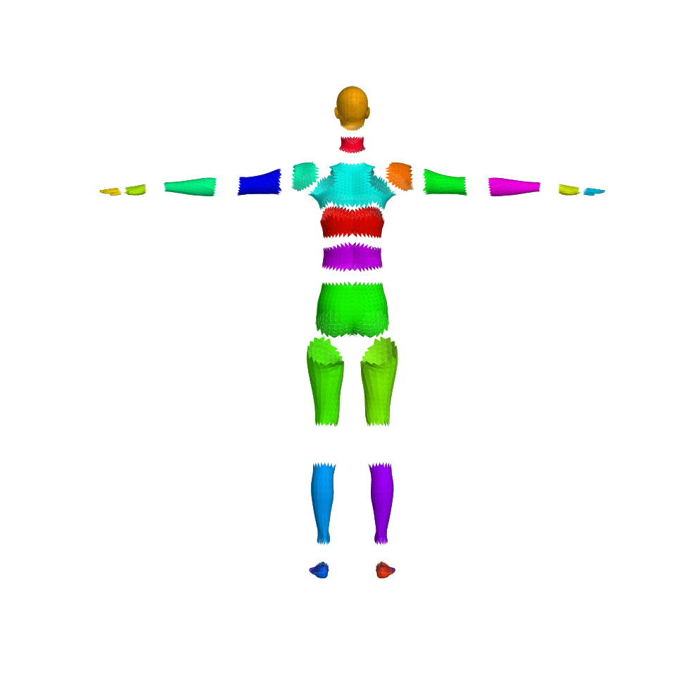
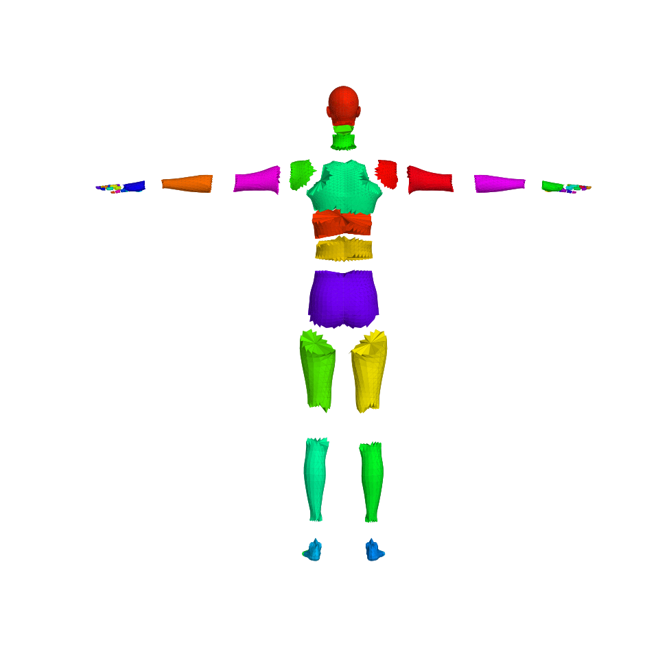
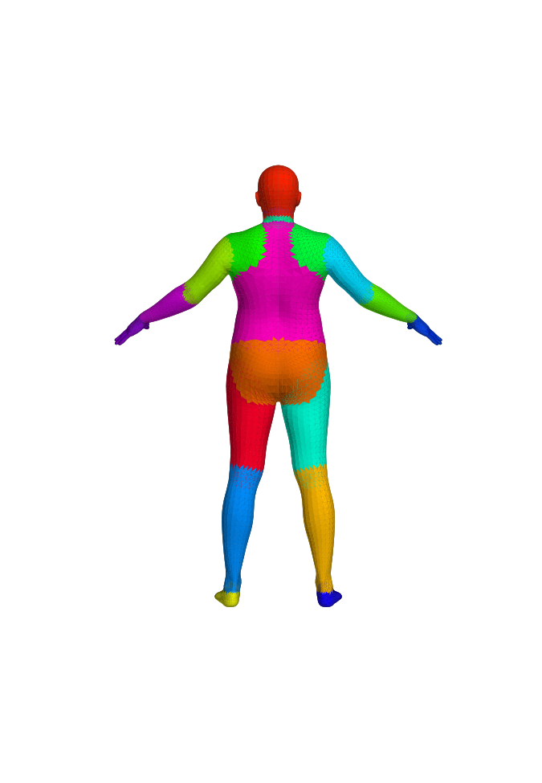
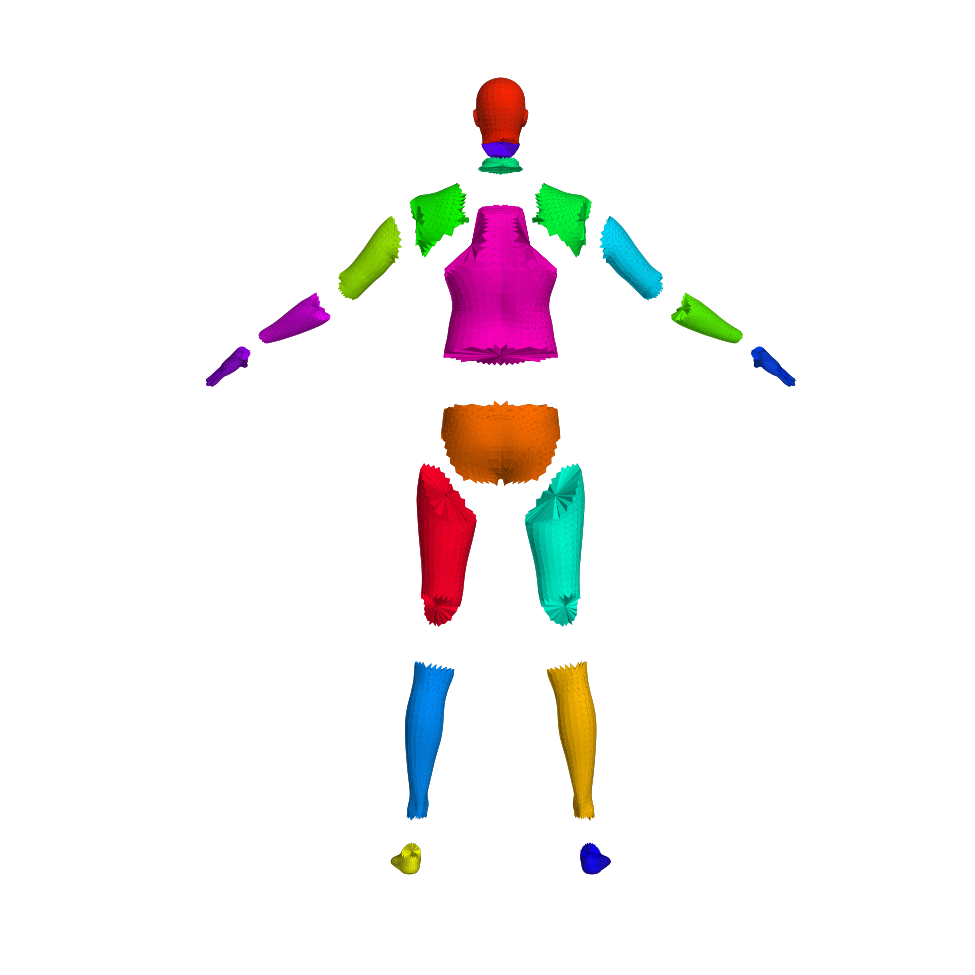

# Segmentation

Human mass and dynamics need each vertex assigned to the body part it moves
with, and each part closed into a solid whose volume, centre of mass, and
inertia can be integrated. BetterHuman derives that closed part topology from
**two segmentation sources** that both flow into the one differentiable
`inertia_of_mesh` integrator (`src/better_human/mass/`). This page explains what the two
sources are, why the authored one preserves volume, and when each is used — the
images make the difference visible.

## Two sources, one closed topology

- **Authored closed-3D segmentation** (`PartTopology.from_closed_faces`). A vetted
  archive (`src/better_human/io/assets/smpl_segmentation.npz`, format
  [`better_human.segmentation`](../reference/formats/segmentation.md)) ships per-part face tables that index the concatenation
  `[vertices; joints]` (the mesh and its joint positions): each part is a surface patch of the body
  mesh whose open boundary is closed by triangles fanning to a **rest joint used
  as a cap vertex**. Winding is fixed once from the rest geometry with
  BetterRobot's non-strict `orient_faces_by_component`, which tolerates the
  seam parts that are not strict manifolds. This is the default for SMPL-family
  models that ship the asset (SMPL does; SMPL-H's 52 joints are not its 24 parts).

- **Argmax fallback** (`PartTopology.from_part_ids`). For models without an authored
  asset, each vertex is assigned to its strongest-weighted skinning joint
  (`segment_vertices`), a face joins the part held by at least two of its
  vertices, and every open boundary loop (split into simple loops at a pinch) is closed by reverse-wound
  triangle fans. A loop that borders one neighbouring part is fanned about its **centroid**; a loop that borders
  several is cut into one run per neighbour, each fanned about the run's centroid over the run and the chord
  between its end junctions, and three or more junctions are fanned about their centroid. Both neighbours compute
  each centroid from the same vertices, so their caps coincide. MHR maps the winning native joint
  through the converted reference segmentation to 19 grouped parts before this
  step. This is the generic path; SMPL-X and MHR use it because neither ships an
  authored closed-3D asset.

Both produce one `mass.PartTopology`, stay batched, and remain differentiable
with respect to shape through the cap vertices. `mass.part_inertias` integrates each part at its density: by
default the `"Dempster"` table, each part at the density of the category its family declares
(`Parts.density_categories`, [density tables](../reference/formats/density_tables.md)).

## Why the parts sum back to the body

Shared caps are the reason the parts sum back to the whole body. Where two parts meet, both close their shared
opening with the **same** cap: the authored parts fan to the same rest joint, the argmax parts to the same
centroid of the same vertices. The cap surface one part adds is then the exact reverse of the cap its neighbour
adds, so the internal caps cancel in signed volume and the closed parts telescope back to the original surface.
Every part is a closed, consistently wound mesh; `PartTopology` raises for one that is not. Measured on the
neutral SMPL fixture at 1000 kg/m³ (24 parts each):

| Quantity | Authored closed-3D | Argmax fallback |
|---|---|---|
| 24-part volume sum vs whole mesh | **-0.0071 %** (-71 ppm) | **0** (exact up to rounding) |
| Total part mass (whole mesh 74.761 kg) | 74.755 kg | 74.761 kg |
| Aggregate vs whole-mesh COM separation | 0.03 mm | 0.00 mm |

The authored residual sits at the shoulders: where `spine3` meets a collar, three authored cap triangles and the
shoulder face that both parts once listed (dropped so that both parts close) leave a 2.6 mL sliver in no part.
The argmax closure leaves a residual only where a junction polygon (three or more parts meeting on one loop) has
no neighbour that shares it: SMPL-H's hands (-4.1 ppm) and SMPL-X's jaw and head (-17 ppm);
`tests/mass/test_closure.py` holds the bound for each family. The two segmentations cut the body in different
places, so their part masses differ even where both conserve the total.

## When each is used

The authored closed-3D segmentation is SMPL's: it is an
anatomical cut and needs no runtime boundary tracing. The argmax
fallback is the generic path for any model that ships no authored asset —
SMPL-H, SMPL-X and MHR today, and every future model until an authored asset is added
for it. SMPL and SMPL-X also have authored **per-vertex** labelings
(`*_vert_segmentation.json`) used only to color the intact surface; MHR does
not. SMPL-X's closed topology still comes from argmax because its per-vertex
labeling is not a closed-3D asset.

## SMPL

The authored surface colors the mesh by the named per-vertex parts; the authored
split shows the closed, joint-capped solids fanning to shared rest joints. The
argmax surface colors by strongest skinning joint; its split shows the
centroid-capped parts.

| Authored closed-3D | Argmax fallback |
|---|---|
|  |  |
|  |  |

The authored split parts are closed volumes (note the solid caps at every
joint); the argmax split parts are closed by centroid fans that their neighbours share.

## SMPL-X

SMPL-X ships no authored closed-3D asset, so its authored column is the
per-vertex surface labeling and an exploded view of the **open** surface shells
that labeling induces — a partition of the surface, not a set of solids. Its
closed topology, and therefore its mass, come from the argmax fallback (the
per-finger joints appear as their own parts).

| Authored per-vertex labeling | Argmax fallback |
|---|---|
|  |  |
|  |  |

The authored split shells are open (they have no joint caps); the argmax split
parts are the closed, centroid-capped solids that feed SMPL-X inertias.

## MHR

MHR ships neither an authored per-vertex labeling nor an authored closed-3D
asset. Its converted reference segmentation groups strongest-skinning-joint
ownership into 19 physical parts. The intact surface and the exploded view
below show those grouped argmax parts; the exploded meshes are the
centroid-capped solids that feed MHR inertias.

| Grouped argmax surface | Grouped argmax split |
|---|---|
|  |  |

An authored partition remains roadmap work.

## Regenerate the images

The PNGs are reproducible. After an intentional change to segmentation data, topology
construction or the renderer, run from the repository root:

```bash
uv run python docs/render_segmentation.py --models-dir "$BETTERHUMAN_MODELS_DIR"
```

The script uses headless matplotlib, fixed colours and a fixed camera. It rewrites each
available SMPL, SMPL-X and MHR image under `docs/segmentation/` and skips models whose weights
are absent. Inspect every changed PNG; unchanged inputs give the same bytes.

## Where next

- [Architecture](architecture.md): where parts live in the package.
- [Studio](../studio.md): paint and inspect parts interactively.
