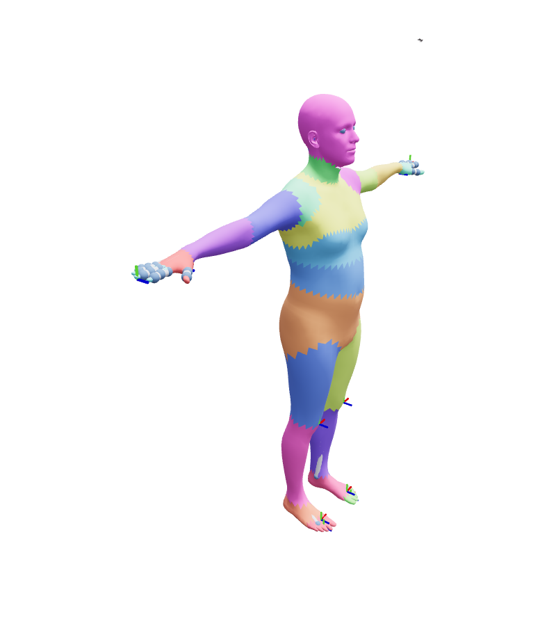

# Getting started

This page installs BetterHuman, points it at the body weights, loads an SMPL body, poses a
batch of four frames, and shows them in the BetterRobot viewer.

## Install with uv

BetterHuman lives next to BetterRobot and installs it as an editable path dependency.

```bash
cd BetterHuman
uv sync                      # add --extra viewer for the browser viewer, --extra studio for HumanStudio
export BETTERHUMAN_MODELS_DIR=$PWD/models
```

!!! note "Weights are not shipped"
    Licensed weights stay outside git. Loaders read
    `$BETTERHUMAN_MODELS_DIR/<family>/` (`smpl/`, `smplx/`, `MHR/`, ...); the `README` lists the
    expected file names and the chumpy-to-npz converter.

## Load a body and bake a subject

`load` builds one `Body` per family. `bake` applies the identity (shape) once and returns an
`Identity` whose `model` is a BetterRobot `Model`.

```python
import torch
import better_human as bh

body = bh.load("smpl")
subject = body.bake(betas=torch.zeros(10))
print(type(subject.model).__module__, subject.model.nq, subject.model.nv)
print(body.joint_names[:4])
```
```output
better_robot.data_model.model 99 75
('pelvis', 'left_hip', 'right_hip', 'spine1')
```

## Pose a batch and run forward kinematics

`q` has `nq` entries and the tangent `v` has `nv`; build poses with `model.integrate`, never by
adding to `q`. `forward` runs BetterRobot forward kinematics once for the whole batch.

```python
model = subject.model
v = torch.zeros(4, model.nv)
elbow = model.idx_vs[model.joint_name_to_id["left_elbow"]]
v[:, elbow + 1] = torch.linspace(0.0, 1.5, 4)
state = subject.forward(model.integrate(subject.q_neutral, v))
print(type(state.kinematics).__name__, tuple(state.joints.shape), tuple(state.vertices.shape))
```
```output
KinematicState (4, 24, 3) (4, 6890, 3)
```

`state.kinematics` is the BetterRobot `KinematicState`, so frame Jacobians and dynamics work on
it unchanged. `vertices` (a property) skins the mesh on first access and memoises the result.

## View the clip

`human_layers` turns a posed batch into viewer layers: the batch axis is the timeline.

```python
from better_robot.viewer import Viewer
from better_human.viz.human_layers import human_layers

viewer = Viewer()                 # viser on 127.0.0.1:8080
for layer in human_layers(state):
    viewer.add(layer)
viewer.show(3)                    # jump to the most bent frame
```

For interactive work on one body (shape sliders, part painting, contact frames) use HumanStudio:



## Where next

- [Architecture](concepts/architecture.md): what BetterHuman adds on top of BetterRobot.
- [Segmentation](concepts/segmentation.md): how the mesh splits into parts and masses.
- [Studio](studio.md): launch flags and the sidebar.
