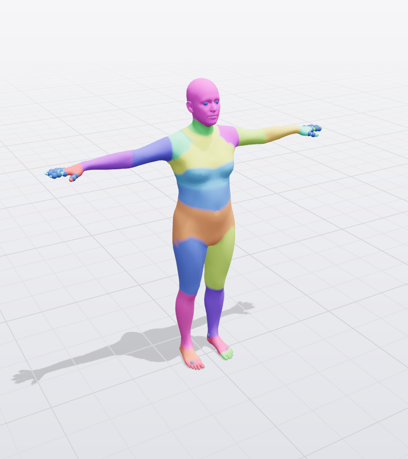
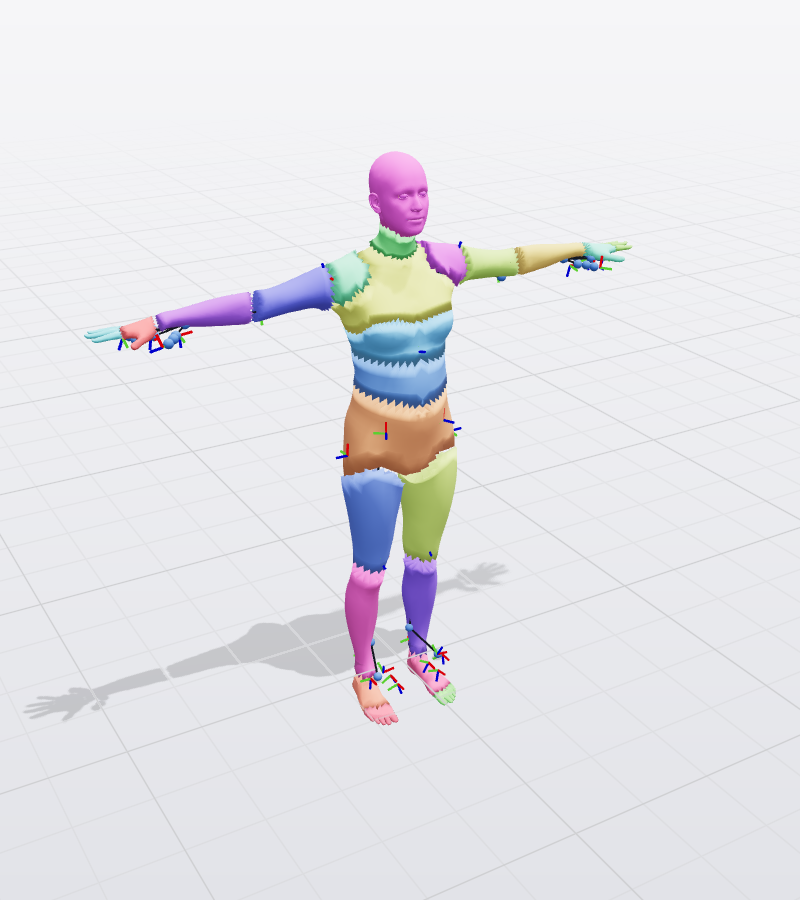

# Use the studio

HumanStudio is a browser app (viser) for authoring data on SMPL, SMPL-X and MHR bodies: shape and pose, mass
density, vertex segmentations (body parts) and named contact frames. Everything it saves is a plain versioned JSON
file under the data root you pass, so scripts load the same data without the app. This guide launches it and walks
through the sidebar. It reads licensed weights: set `$BETTERHUMAN_MODELS_DIR` first ([Load a family](load-a-family.md)).



## Launch

```bash
uv sync --extra studio
uv run python -m better_human.studio --data-root ~/studio_data --family smplx
# open http://127.0.0.1:8080
```

| Flag | Default | Meaning |
|------|---------|---------|
| `--family` | `smpl` | `smpl`, `smplx` or `mhr` |
| `--gender` | `neutral` | `neutral`, `male`, `female` |
| `--lod` | `1` | MHR level of detail |
| `--port` / `--host` | `8080` / `127.0.0.1` | where viser listens (the next free port when 8080 is taken); keep the host local |
| `--data-root` | required | the directory everything the studio saves goes to; there is no default |

The weights come from `$BETTERHUMAN_MODELS_DIR` through `better_human.io.models_dir()`; unset, the load fails naming
the variable. `--seed` (default 0) seeds the random shapes. From Python,
`better_human.studio.launch(data_root="~/studio_data", generator=numpy.random.default_rng(0), family="smplx")` does
the same and blocks;
`HumanStudio(..., server=viser.ViserServer(...))` builds the app without blocking.

## The sidebar

The scene holds the body, its native skeleton, the selected joint and the named frames, on a ground under the feet.
The sidebar is BetterRobot's: **Layers** first, then the studio's sections.

**Layers** holds one checkbox per group of layers: **Body**, **Skeleton** (joints and bones), **Selection** (the
selected joint and the vertices an editor marks) and **Frames** (the named frames as small axes). Unchecking hides
the group; the app keeps updating it in the background.

### Status

The status line (what was loaded, saved or refused), the selection (model, joint, frame) and the buttons **Reset
pose**, **Deselect joint** and **Deselect frame**.

### Model

Pick **Family**, **Gender** and **LOD** (MHR only), then press **Load**. The shape, pose and layers are rebuilt
for the new body, and so are the sections below; the layer checkboxes keep their state.

### Display

- **Colour** chooses how the body is drawn:
  - `skin`: one flat skin colour;
  - `segmentation`: each vertex in its part's colour (the editing view; always opaque);
  - `parts`: each part drawn as its own closed mesh riding its joint, which also enables Explode.
- **Opacity** of the body, **Joint radius** of the skeleton, and **Explode**, which pushes each part away from the
  centre so parts are easy to inspect. All three change the live scene in place.

### Body

- A slider per coefficient of each shape group (`betas`, and `expression` on SMPL-X), plus **Reset** and
  **Random** buttons for the group.
- **Density**: a uniform value in kg/m^3 or a saved per-part density; **Apply density** rebuilds the body, and
  the mass line below shows the new total mass.

### Pose

Click a joint in the 3D view to select it and drag the gizmo that appears to rotate it (the root also moves). **Save
pose** under **Pose name**, and **Saved poses** + **Load pose**.

### Segment

- **Part** selects the part to paint; **New part** + **Add part** creates one.
- **Paint (click mesh)**: clicking the mesh paints the vertices within **Brush radius** into the selected part;
  **Marquee select** paints a screen rectangle.
- **Saved** + **Load segmentation**, **Save as** + **Save segmentation**, **Load built-in** (the
  skinning-weight partition shipped with the model), **Reset to skinning**, and **Build bodies**,
  which prints the mass of each part.



### Frames

Named frames (for example foot contact points) are the model's contact frames: each sits on a mesh vertex, rigid
with a parent joint, its z axis the rest surface normal there, drawn as `HumanState.contact_frame_poses` places
them. MHR takes no contact frames, so adding one there is refused on the status line.

- **Add frames (click mesh)**: click the mesh to drop a frame on the nearest vertex, parented to its dominant
  skinning joint.
- **Frame** picks the active frame; **Name** + **Rename**; **Parent joint** re-parents it; **Delete**.
- **Saved** lists the frame sets saved for this model (for example `contacts`); **Load frames**,
  **Save as** + **Save frames**, and **Export as config**, which prints a Python dict for
  `better_human` body construction.
- An empty frame set is valid: the frames layer simply draws nothing.

## Data layout

```text
<data root>/
  segmentations/<key>/<name>.json   # better_human.studio.segmentation v1: {format, format_version, parts}
  frames/<key>/<name>.json          # better_human.frame_set v1: {format, format_version, frames}
  poses/<key>/<name>.json           # better_human.studio.pose v1: {format, format_version, joint_names, q}
```

`<key>` names the model, for example `smplx_neutral` or `mhr_lod1`, so sets saved for one body
never load onto another. The SMPL-X contact set ships as package data,
`better_human.io.shipped_frame_set("smplx_contacts")`, not as a file under the data root. A frame-set file is the
versioned format `better_human.frame_set` ([spec](../reference/formats/frame_set.md)).

## Known limitations

- The body is always the exact mesh (pose correctives included), never a mesh skinned in the browser: viser 1.1.1
  turns the page white when a skinned mesh is removed or replaced with a browser open, and a body swap replaces the
  body. A change of colour mode or body therefore sends the whole mesh again; it takes a fraction of a second on
  SMPL-X.
- In the `segmentation` mode the colours blend across the faces that join two parts, and the body stays opaque.
- Edits from several browser tabs at once are serialised by one lock; the last edit wins.

## Where next

- [Load a family](load-a-family.md): read a saved frame set with `io.read_frame_set` and attach it as contact frames.
- [Segmentation](../concepts/segmentation.md): how the parts the studio paints become closed solids with masses.
