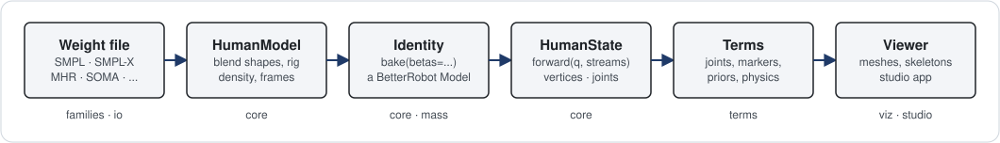

# BetterHuman

BetterHuman loads parametric human bodies (SMPL, SMPL-H, SMPL-X, MANO, FLAME, MHR and SOMA) as
[BetterRobot](https://github.com/rihat99/BetterRobot) models. A body is then one more robot: batched, differentiable
forward kinematics, Jacobians, dynamics, solvers and the browser viewer all work on it.

The idea is one short pipeline. A family's weight file becomes a `HumanModel`. Baking a shape gives an `Identity`,
whose `model` is a plain BetterRobot `Model` with the subject's joints and masses. `identity.forward(q)` poses it and
returns a `HumanState`: vertices, joints and frames, each computed the first time you read it. Fitting terms turn
the state into least-squares problems for BetterRobot's solvers, and the viewer shows the result.

{ width="960" }

Here is the whole pipeline on the random-weight SMPL archive the repository ships for its tests. Its numbers are
random in SMPL's layout, so the body looks like noise, but every name and shape is the one the real SMPL file gives,
and you need no licensed weights to run it.

```python
import torch
import better_human as bh
from better_robot.kinematics import integrate

human = bh.load("smpl", "tests/support/random_weights/smpl_random.npz")
subject = human.bake(betas=torch.zeros(10))  # shape once
model = subject.model  # a BetterRobot Model

v = torch.zeros(4, model.nv)  # a batch of 4 poses
elbow = model.idx_vs[model.joint_id("left_elbow")]
v[:, elbow + 1] = torch.linspace(0.0, 1.5, 4)  # bend the left elbow
state = subject.forward(integrate(model, model.q_neutral, v))
print(model.nq, model.nv)
print(state.vertices.shape, state.joint_translations.shape)
```
```output
99 75
torch.Size([4, 6890, 3]) torch.Size([4, 24, 3])
```

The batch never shows up in the code: it rides along in `q`.

## The modules

| Page | Packages | What you do with them |
|---|---|---|
| [Families and files](families.md) | `families`, `io` | load a family with its options, contact frames, the family's own parameters |
| [Bodies](bodies.md) | `core` | shape a subject, pose it in batches, read vertices, joints and frames |
| [Mass](mass.md) | `mass` | part masses and inertias, so BetterRobot's dynamics apply |
| [Fitting terms](terms.md) | `terms` | fit poses and shapes to joints, markers and images with BetterRobot's solvers |
| [Viewer](viewer.md) | `viz` | show bodies and clips in the browser |
| [Studio](studio.md) | `studio` | an app to pose, shape, paint parts and place contact frames |

Start with [Install and weights](install.md).
