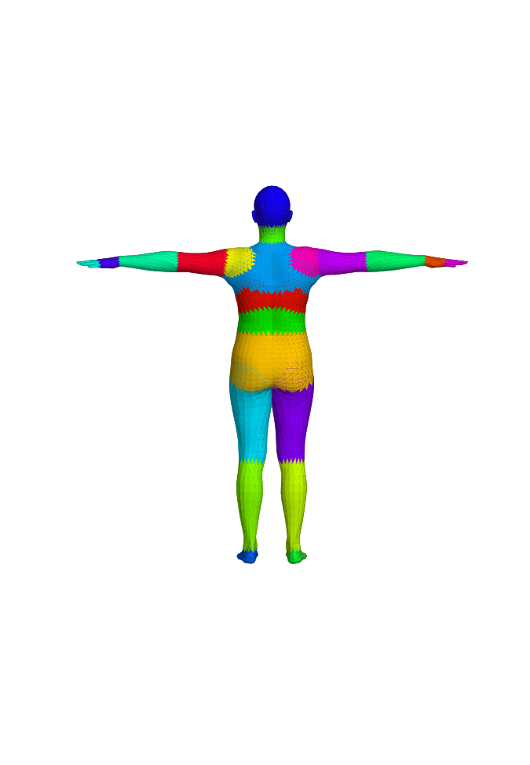
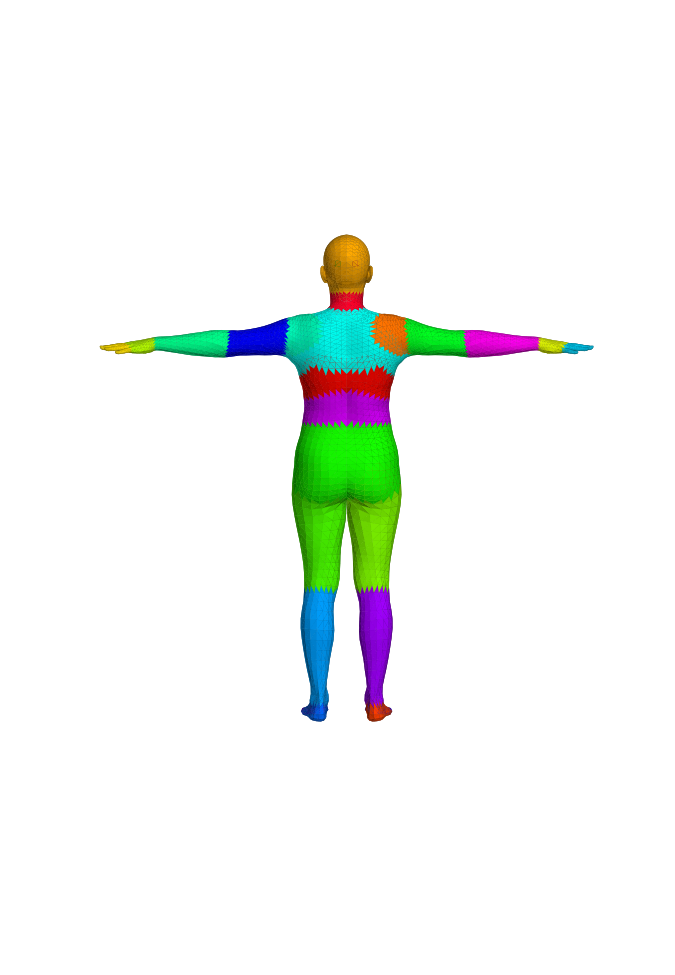
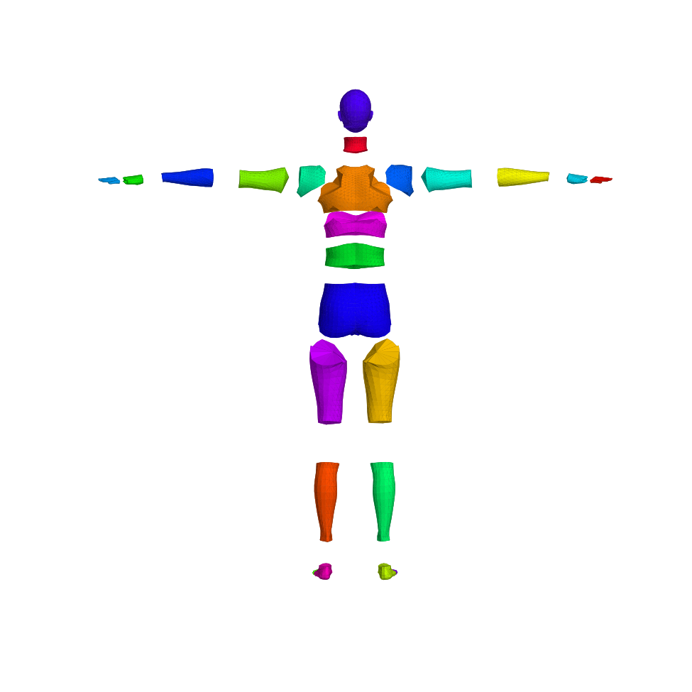
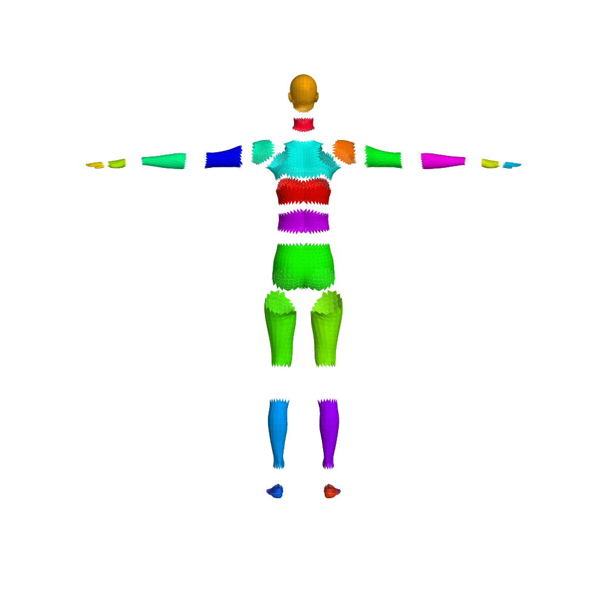
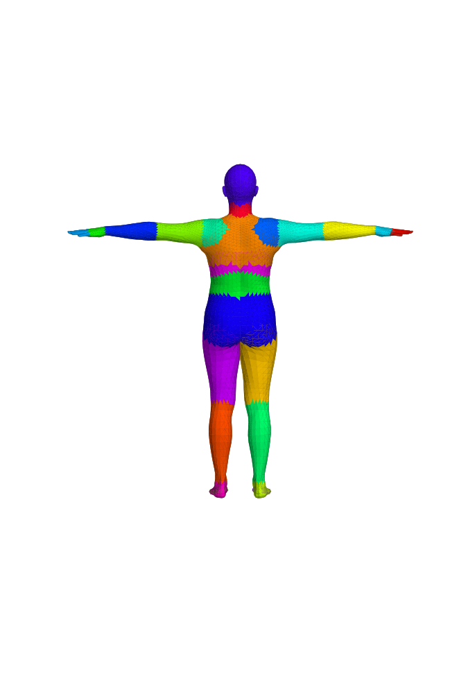
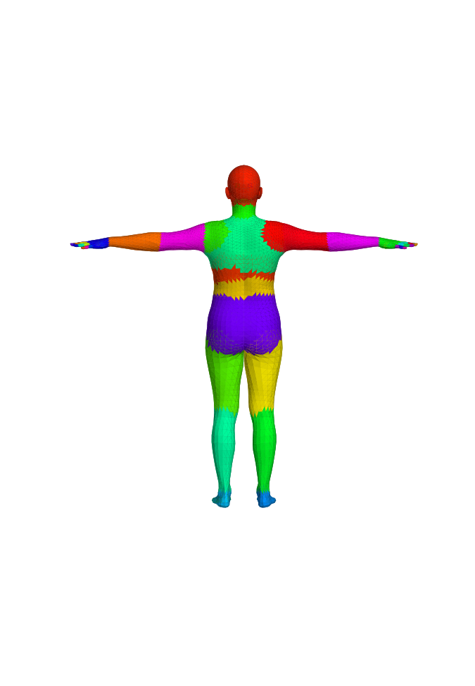
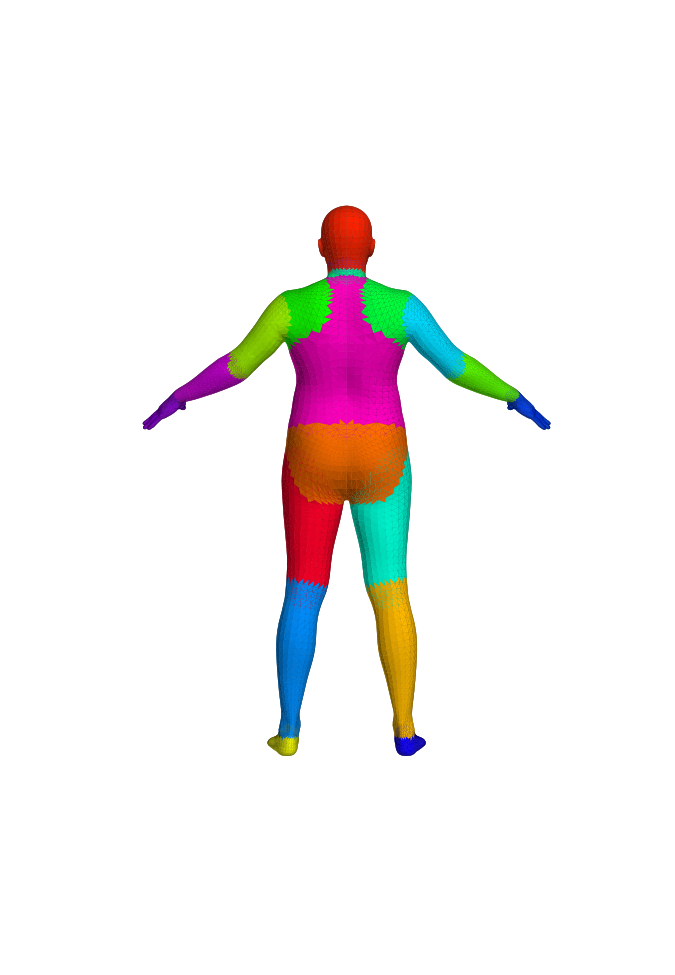
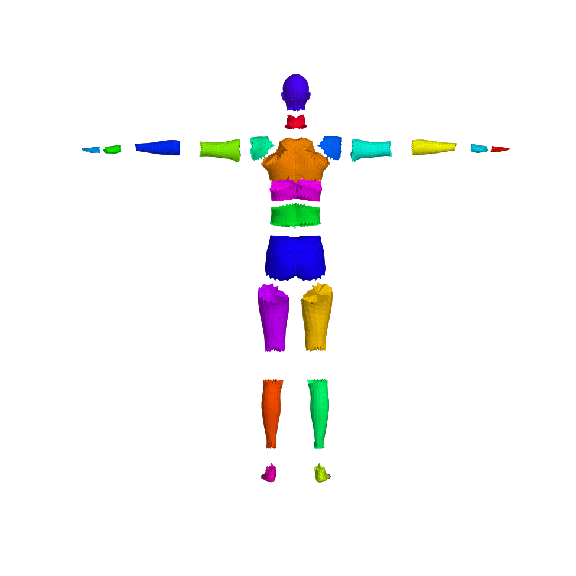
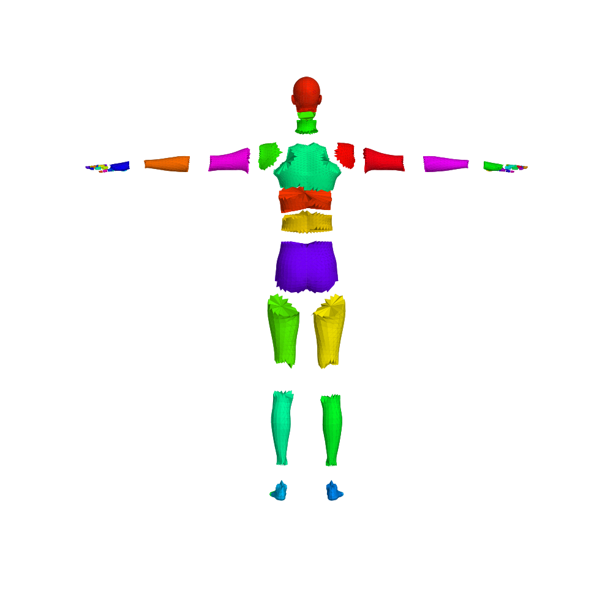
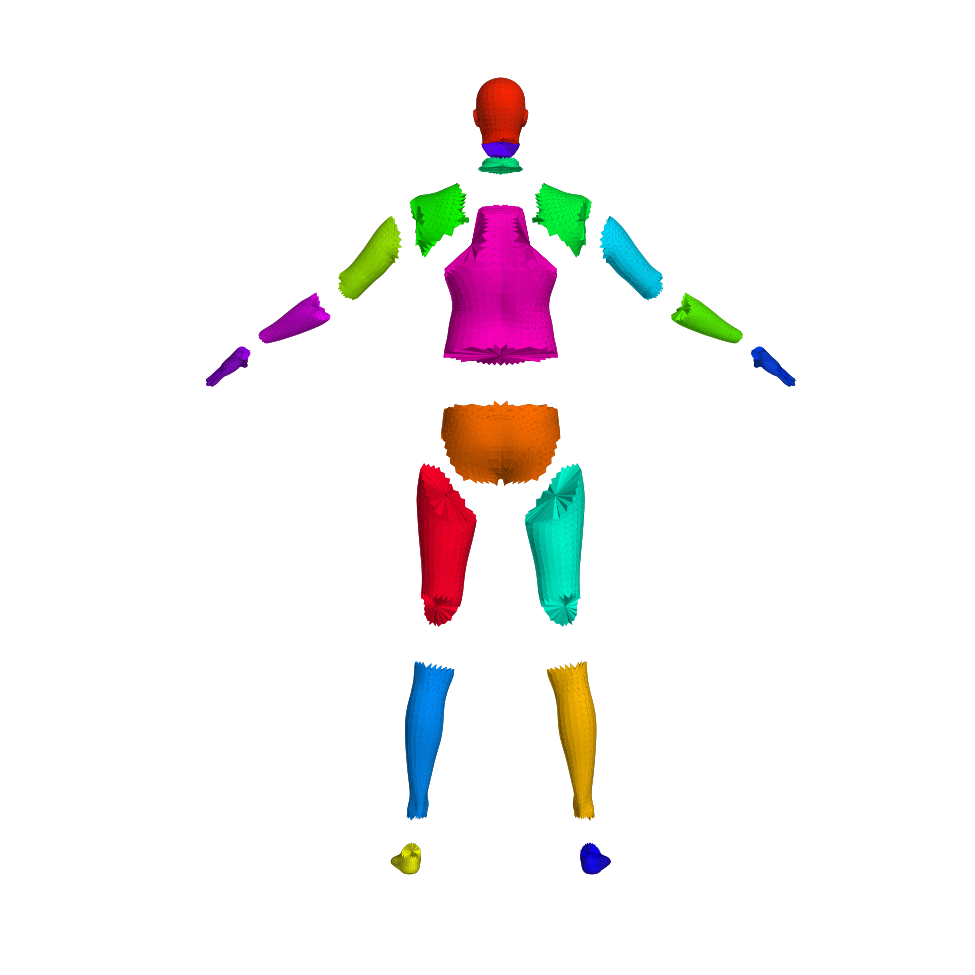

# Mass

A body needs masses for dynamics: joint torques, contact forces, the centre of mass. BetterHuman cuts the mesh into
parts, each carried by a joint, closes each part into a solid, and integrates its mass and inertia at the part's density. The
inertias go into the subject's BetterRobot `Model` at every bake, so they follow the shape, and gradients flow
through them.

The names you will use:

| Name | What it does |
|---|---|
| `density=` of `bh.load` and `HumanModel.from_spec` | `"Dempster"` (the default) or another table name, a float in kg/m³, or `None` for no masses |
| `identity.model.body_inertias` | `(nbodies, 10)` BetterRobot inertias; column 0 is the mass in kg |
| `mass.PartTopology` | the closed parts of a mesh, built once per `HumanModel` (`human.part_topology`) |
| `mass.part_inertias(vertices, part_poses, *, topology=, density=)` | the inertia of every part of a posed or rest mesh |
| `mass.part_densities`, `mass.segment_vertices` | densities from a table; parts from skinning weights |

The examples on this page read the licensed SMPL-X weights (see [Install and weights](install.md)).

## Body mass and density

A density table gives each part the density of its body segment from the biomechanics literature: `"Dempster"`
(the default), `"Chandler"`, `"Clauser"`, `"Naive"`, and `"Custom"`. A float is one density for the whole body.

```python
import torch
import better_human as bh

for density in ("Dempster", "Chandler", 1000.0):
    subject = bh.load("smplx", density=density).bake()  # zero shape
    print(f"{density}: {float(subject.model.body_inertias[:, 0].sum()):.1f} kg")
```
```output
Dempster: 77.4 kg
Chandler: 71.2 kg
1000.0: 76.0 kg
```

## Dynamics on the body

With masses in the model, BetterRobot's dynamics work on the body. Holding the neutral pose still, the free-flyer
rows of the joint torques are the body's weight and the moment of gravity about the root:

```python
import better_robot as br

subject = bh.load("smplx").bake()
model = subject.model
state = br.forward_kinematics(model, model.q_neutral)
zero = torch.zeros(model.nv)
torques = br.inverse_dynamics(model, state, v=zero, a=zero)
print(f"weight: {float(torques[1]):.1f} N")  # y is up
```
```output
weight: 759.4 N
```

## How the parts close

SMPL ships an authored segmentation whose parts close at the joints. Every other family, SMPL-X, MHR and SOMA
included, closes the parts of its strongest skinning joints with caps at the centroid of each seam. Neighbours share
their caps, so the parts add up to the whole body's volume to within 0.01 % on SMPL and SMPL-X. The ragged seams of
SOMA and of MHR's coarse levels of detail lose more: 2.4 % on SOMA, 16 % at MHR's coarsest level.

| | SMPL | SMPL-X | MHR |
|---|---|---|---|
| authored parts |  |  | |
| authored, pulled apart |  |  | |
| skinning parts |  |  |  |
| skinning, pulled apart |  |  |  |

SMPL-X's authored parts are open shells that colour the studio, not solids; its masses come from the skinning
parts. `uv run python tools/render_segmentation.py` redraws these images from your weights.

See also: [Bodies](bodies.md) for the bake, and BetterRobot's dynamics for what the masses are used for.
