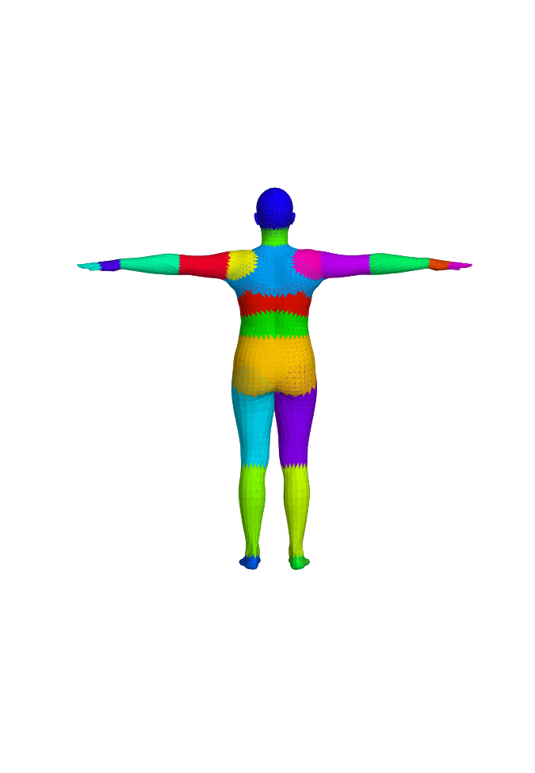
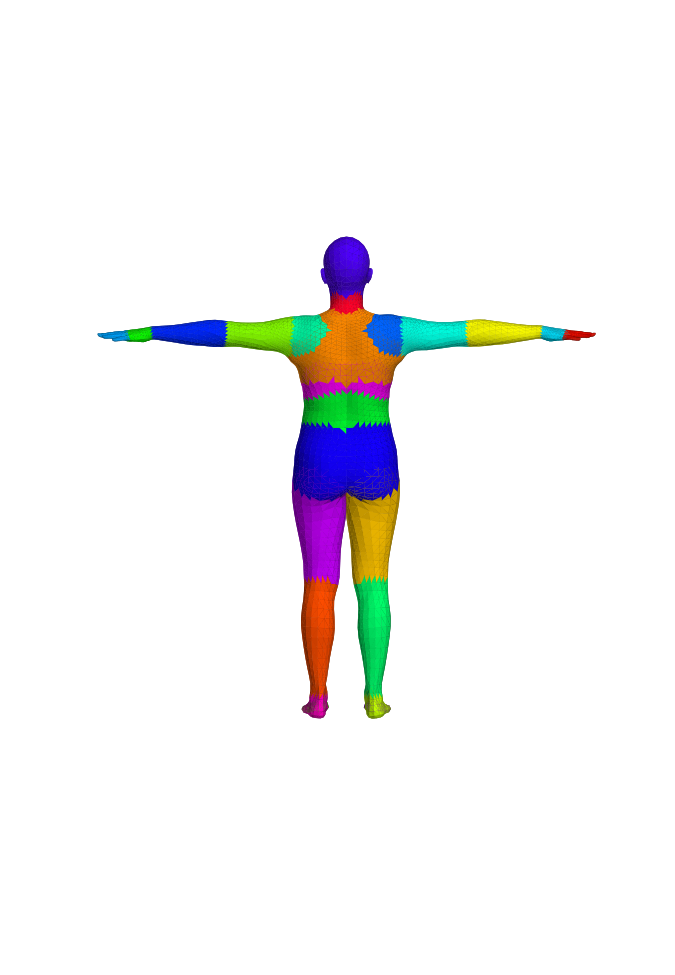
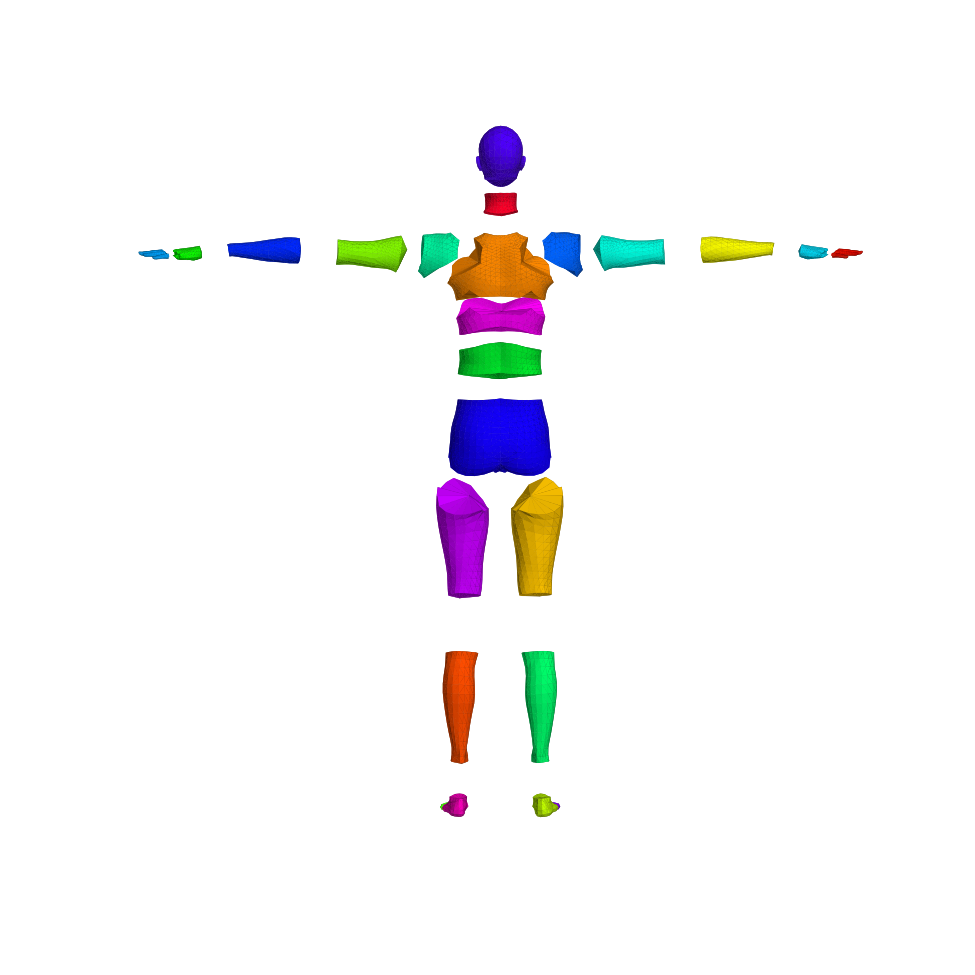
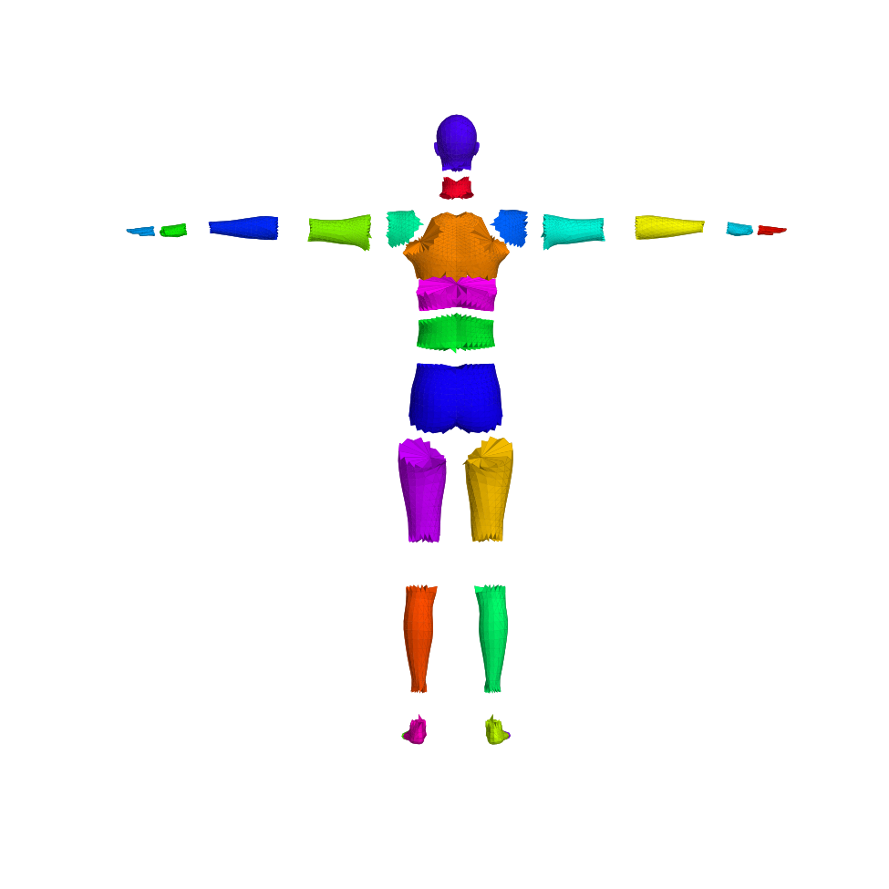
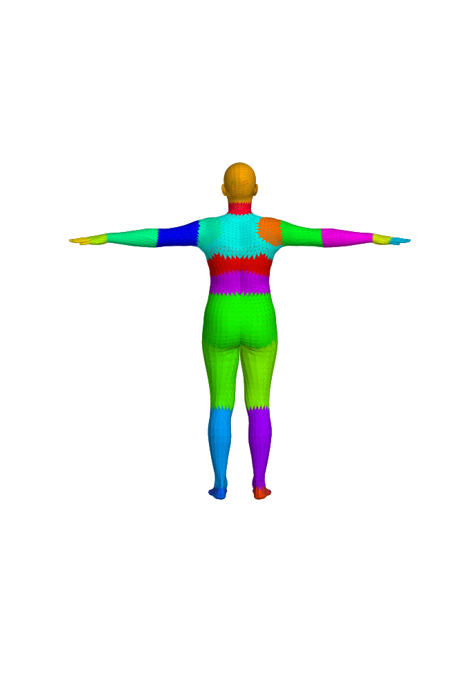
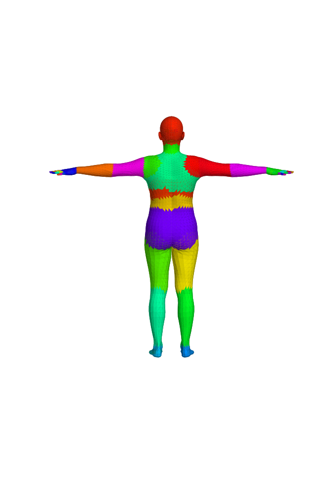
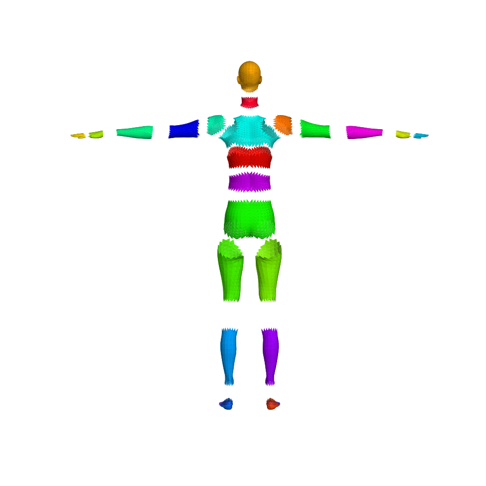
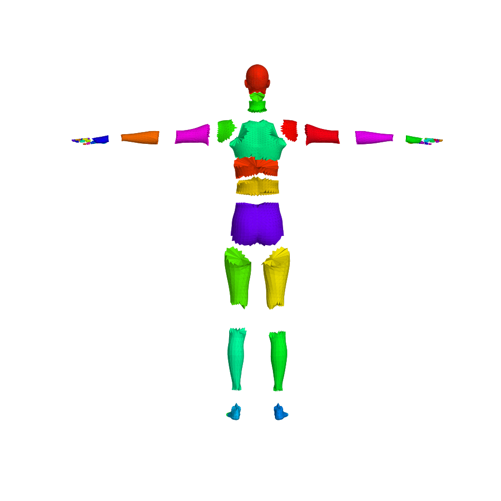

# Segmentation

Human mass and dynamics need each vertex assigned to the body part it moves
with, and each part closed into a solid whose volume, centre of mass, and
inertia can be integrated. BetterHuman derives that closed part topology from
**two segmentation sources** that both flow into the one differentiable
`Inertia.from_mesh` integrator (`core/mass.py`). This page explains what the two
sources are, why the authored one preserves volume, and when each is used — the
images make the difference visible.

## Two sources, one closed topology

- **Authored closed-3D segmentation** (`build_authored_topology`). A vetted
  asset ships per-part face tables that index the concatenation
  `[shaped_vertices; rest_joints]`: each part is a surface patch of the body
  mesh whose open boundary is closed by triangles fanning to a **rest joint used
  as a cap vertex**. Winding is fixed once from the rest geometry with
  BetterRobot's non-strict `orient_faces_by_component`, which tolerates the
  seam parts that are not strict manifolds. This is the default for SMPL-family
  models that ship the asset (SMPL does).

- **Argmax fallback** (`build_part_topology`). For models without an authored
  asset, each vertex is assigned to its strongest-weighted skinning joint
  (`segment_vertices`), a face joins the part held by at least two of its
  vertices, and every resulting open boundary loop is closed by a reverse-wound
  triangle fan about that loop's **centroid**. This is the generic path; SMPL-X
  uses it, since it ships no authored closed-3D asset.

Both produce one `PartMeshTopology`, stay batched, and remain differentiable
with respect to shape through the cap vertices.

## Why the authored partition preserves volume

The authored caps are the reason the parts sum back to the whole body. Where two
parts meet at a joint, both close their shared opening by fanning to the **same**
rest-joint position, so the cap surface one part adds is the exact reverse of the
cap its neighbour adds. Summed over the body, those internal caps cancel in
signed volume and the 24 closed parts telescope back to the original surface.

Three SMPL parts — `spine3`, `left_collar`, `right_collar` — are genuinely open
and non-manifold at the shoulder-girdle seam, so their individual absolute
volumes are origin-dependent. `Inertia.from_mesh` integrates each part about its
own mean, which makes the *aggregate* exact even though those three parts are
open. Measured on the neutral SMPL fixture at 1000 kg/m³:

| Quantity | Authored closed-3D | Argmax fallback |
|---|---|---|
| 24-part volume sum vs whole mesh | within **+0.0055 %** (+54 ppm) | **+1.78 %** |
| Total part mass (whole mesh 74.76 kg) | **74.76 kg** | 73.43 kg |
| Aggregate vs whole-mesh COM separation | **0.02 mm** | 2.47 mm |

The authored partition closes the 1.78 % gap the centroid-capped argmax path
carries, which is why it is preferred wherever the asset exists.

## When each is used

The authored closed-3D segmentation is the SMPL-family default: it is the
volume-preserving choice and needs no runtime boundary tracing. The argmax
fallback is the generic path for any model that ships no authored asset — SMPL-X
today, and every future model until an authored asset is added for it. A model
also has an authored **per-vertex** labeling (`*_vert_segmentation.json`) used
only to color the intact surface; for SMPL-X that per-vertex labeling exists but
there is no authored closed-3D asset, so its closed topology comes from argmax.

## SMPL

The authored surface colors the mesh by the named per-vertex parts; the authored
split shows the closed, joint-capped solids fanning to shared rest joints. The
argmax surface colors by strongest skinning joint; its split shows the
centroid-capped parts.

| Authored closed-3D | Argmax fallback |
|---|---|
|  |  |
|  |  |

The authored split parts are closed volumes (note the solid caps at every
joint); the argmax split parts are closed by centroid fans and carry the 1.78 %
volume gap above.

## SMPL-X

SMPL-X ships no authored closed-3D asset, so its authored column is the
per-vertex surface labeling and an exploded view of the **open** surface shells
that labeling induces — a partition of the surface, not a set of solids. Its
closed topology, and therefore its mass, come from the argmax fallback (the
per-finger joints appear as their own parts).

| Authored per-vertex labeling | Argmax fallback |
|---|---|
|  |  |
|  |  |

The authored split shells are open (they have no joint caps); the argmax split
parts are the closed, centroid-capped solids that feed SMPL-X inertias.

## Regenerating the images

`docs/render_segmentation.py` regenerates every image above with headless
matplotlib and a fixed camera, so re-runs are byte-stable. Weights resolve
through the normal loader; any model whose weights are absent is skipped:

```bash
uv run python docs/render_segmentation.py --models-dir "$BETTERHUMAN_MODELS_DIR"
```
