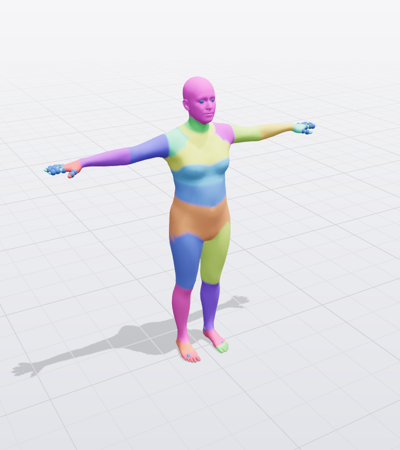
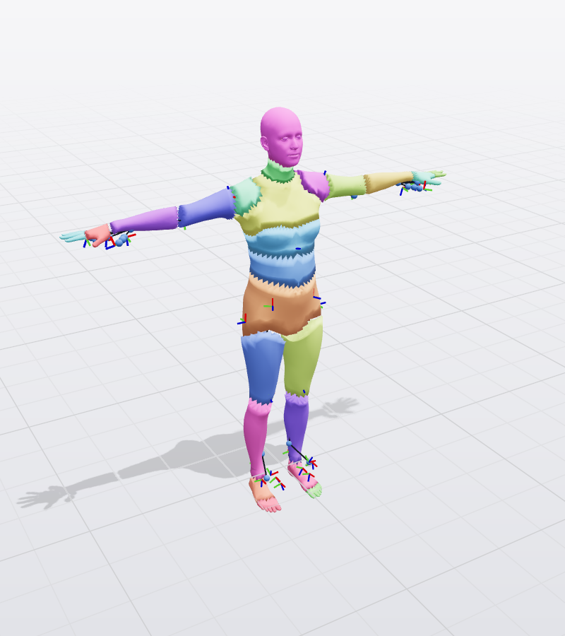

# Studio

HumanStudio is a browser app for authoring data on SMPL, SMPL-X and MHR bodies: shape and pose, density, body parts
and named contact frames. Everything it saves is a small versioned JSON file under a folder you choose, so your
scripts load the same data without the app. It reads your licensed weights through `$BETTERHUMAN_MODELS_DIR`
([Install and weights](install.md)).



## Launch

```bash
uv sync --extra studio
uv run python -m better_human.studio --data-root ~/studio_data --family smplx
# open http://127.0.0.1:8080
```

`--family` is `smpl`, `smplx` or `mhr`; `--gender` and `--lod` (MHR's level of detail) pick the file, and `--port`
the port. From Python, `better_human.studio.launch(data_root=..., family="smplx")` does the same.

## What it does

The sidebar has a section per job:

- **Model**: switch family, gender and level of detail.
- **Display**: colour the body by skin, by part, or as separate part solids you can pull apart; opacity and joint
  size.
- **Body**: sliders for the first ten coefficients of each shape group (`betas`; MHR's `identity` and
  `proportions`), random and reset per group; the density (the `"Dempster"` table, as in the library, until you
  pick another), with the mass it gives.
- **Pose**: click a joint, drag the gizmo to rotate it (the root also moves), save and load poses.
- **Segment**: paint vertices into parts with a brush or a rectangle, load the built-in parts, build the part solids
  and read each part's mass.
- **Frames**: click the mesh to drop a contact frame on a vertex, rename it, re-parent it, save the set.



## What it saves

```text
<data root>/
  segmentations/<model>/<name>.json   # better_human.studio.segmentation: parts as vertex lists
  frames/<model>/<name>.json          # better_human.frame_set: name -> (vertex, joint)
  poses/<model>/<name>.json           # better_human.studio.pose: joint names and q
```

`<model>` names the body, for example `smplx_neutral` or `mhr_lod1`, so a set saved for one body never loads onto
another. A saved frame set goes straight into a body: `bh.load("smplx", contact_frames=io.read_frame_set(path))`.

The body is always the exact mesh, sent whole when the body or the colour changes; viser 1.1.1 blanks the page when
a skinned mesh is replaced with a browser open, and the exact mesh avoids that. MHR takes no contact frames.

See also: [Viewer](viewer.md) for the layers the studio draws with.
