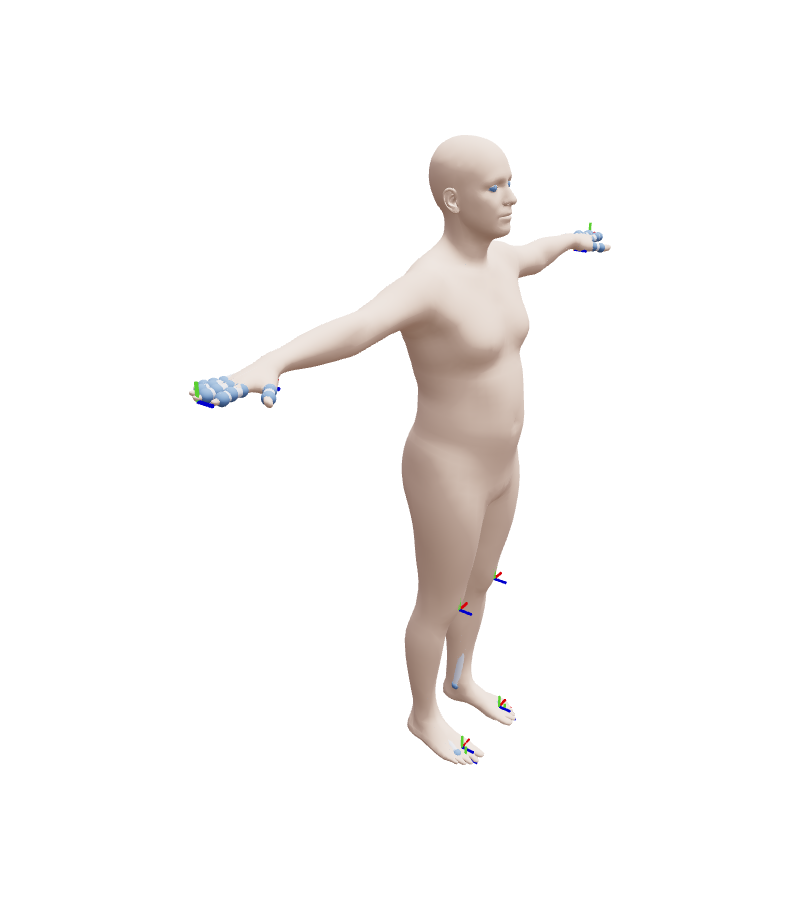

# HumanStudio

HumanStudio is a browser app (viser) for authoring data on SMPL, SMPL-X and MHR bodies: shape and pose,
mass density, vertex segmentations (body parts) and named contact frames. Everything it saves is a plain
JSON/NPZ file under `studio_data/`, so scripts can load the same data without the app.


## Launch

```bash
cd BetterHuman
BETTERHUMAN_MODELS_DIR=$PWD/models uv run python -m better_human.viz.studio --family smplx
# open http://127.0.0.1:8080
```

| Flag | Default | Meaning |
|------|---------|---------|
| `--family` | `smpl` | `smpl`, `smplx` or `mhr` |
| `--gender` | `neutral` | `neutral`, `male`, `female` |
| `--lod` | `1` | MHR level of detail |
| `--port` / `--host` | `8080` / `127.0.0.1` | where viser listens; keep the host local |
| `--models-dir` | `$BETTERHUMAN_MODELS_DIR` or `models/` | weight root |
| `--data-dir` | `<repo>/studio_data` | root for everything the studio saves |

From Python, `better_human.viz.studio.launch(family="smplx", port=8080)` does the same and blocks;
`HumanStudio(..., server=viser.ViserServer(...))` builds the app without blocking.

## The sidebar

The sidebar has a status line, a **Layers** folder and five tabs.

**Layers** holds one checkbox per scene layer: `mesh`, `skeleton` (joints and bones) and `frames`
(the named frames as small axes). Unchecking hides the layer; the app keeps updating it in the background.

### Model

Pick **Family**, **Gender** and **LOD** (MHR only), then press **Load**. The current shape, pose and
layers are rebuilt for the new body; the layer checkboxes and colour mode keep their state.

### Body

- One folder per shape group (`betas`, and `expression` on SMPL-X) with a slider per coefficient,
  plus **Reset** and **Random** buttons for the group.
- **Density**: a uniform value in kg/m^3 or a saved per-part density; **Apply density** rebuilds the
  body and the status line shows the new total mass.
- Pose: click a joint in the 3D view (or use the drag gizmo that appears) to rotate it; **Deselect joint**,
  **Reset pose**, **Save pose** under **Pose name**, and **Saved poses** + **Load pose**.

### Display

**Opacity** of the mesh, **Joint radius** of the skeleton, and **Explode**, which pushes each body part
away from the centre so parts are easy to inspect. All three change the live scene in place.

### Segment

- **Colour** chooses how the mesh is coloured:
  - `skin`: one flat skin colour;
  - `segmentation`: each vertex coloured by its part (the editing view);
  - `parts`: each part drawn as its own mesh, which also enables Explode.
- **Part** selects the part to paint; **New part** + **Add part** creates one.
- Clicking the mesh paints vertices into the selected part; **Marquee select** paints a screen rectangle.
- **Saved** + **Load segmentation**, **Save as** + **Save segmentation**, **Load built-in** (the
  skinning-weight partition shipped with the model), **Reset to skinning**, and **Build bodies**,
  which prints the mass of each part.



### Frames

Named frames (for example foot contact points) are attached to a parent joint with a fixed offset.

- **Frame** picks the active frame; **Name** + **Rename**; **Parent joint** re-parents it; **Delete**.
- **Add frame** mode: click the mesh to drop a frame at that surface point on the nearest joint.
- **Saved** lists the frame sets saved for this model (for example `contacts`); **Load frames**,
  **Save as** + **Save frames**, and **Export as config**, which prints a Python dict for
  `better_human` body construction.
- An empty frame set is valid: the frames layer simply draws nothing.

## Data layout

```text
<repo>/studio_data/
  segmentations/<key>/<name>.json   # part name -> vertex ids
  frames/<key>/<name>.json          # frame name -> (parent joint, offset)
  poses/<key>/<name>.npz            # joint rotations and root
```

`<key>` names the model, for example `smplx_neutral` or `mhr_neutral_lod1`, so sets saved for one body
never load onto another. The repo ships `frames/smplx_neutral/{contacts,better_contacts}.json`.

## Known limitations

- viser meshes have no per-vertex colour channel, so switching the colour mode rebuilds the mesh layer
  (the checkbox and visibility are kept). It takes a fraction of a second on SMPL-X.
- Edits from several browser tabs at once are serialised by one lock; the last edit wins.
