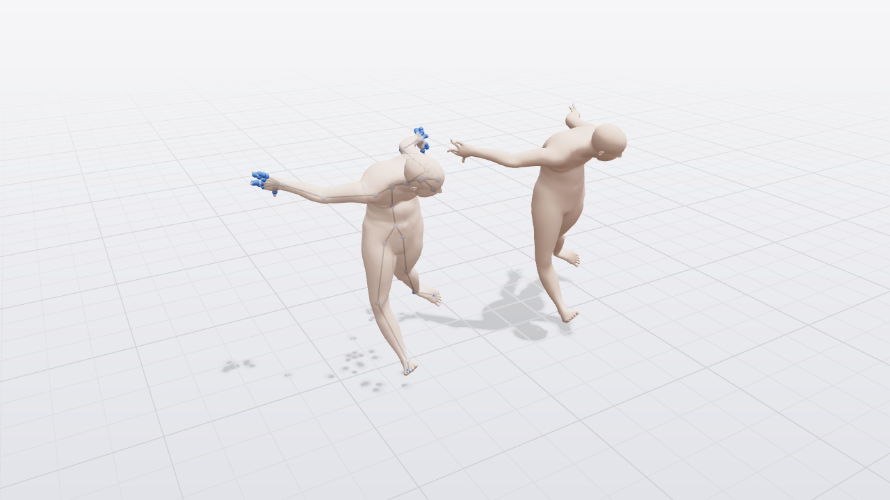

# Viewer

`viz` draws bodies in BetterRobot's browser viewer, built on [viser](https://viser.studio). A posed state with a
batch axis is a clip: the batch is the viewer's timeline. A body is drawn one of two ways. The exact mesh sends the
vertices of every step, pose correctives and expressions included. The skinned body is BetterRobot's
`RobotVisual`, which skins the rest mesh in the browser from the joint poses: much lighter on a long clip, without
pose correctives, and with the viewer's style switch.



The names you will use:

| Name | What it does |
|---|---|
| `human_layers(state, *, mesh="exact", skeleton=True, frames=False, forces=None)` | the layers of a clip, ready for `viewer.add` |
| `mesh_layer(state)` | the exact mesh, one `(T, V, 3)` step per frame; `colors=` paints vertices |
| `skin(identity)` | the rest mesh as a BetterRobot `Skin`, for `RobotVisual(identity.model, q, skin=...)` |
| `skeleton_layers(state)` | the family's own skeleton: a sphere per joint and a line per bone |
| `forces_layer(state, frame_names, forces=)` | arrows for world forces at named frames |
| `HumanView(state)` | the layers of one pose, redrawn in place by `update(state)` |
| `HUMAN_THEME` | BetterRobot's light theme with `+y` up, the axis every family stands on |

## Show a clip

```python
import torch
import better_human as bh
from better_human.viz import HUMAN_THEME, human_layers
from better_robot import Viewer
from better_robot.kinematics import integrate
from better_robot.viewer import GroundLayer

human = bh.load("smpl", "tests/support/random_weights/smpl_random.npz")
subject = human.bake()
model = subject.model
v = torch.zeros(30, model.nv)
v[:, model.idx_vs[model.joint_id("left_elbow")] + 1] = torch.linspace(0.0, 1.5, 30)  # 30 steps
state = subject.forward(integrate(model, model.q_neutral, v))

viewer = Viewer(theme=HUMAN_THEME, ground=False)  # a local viser server: open viewer.url
viewer.add(GroundLayer(height=float(state.vertices[..., 1].min())))  # the pelvis is at the origin
layers = viewer.add(human_layers(state), tags="smpl")
print([layer.name for layer in layers])
```
```output
['mesh', 'joints', 'bones']
```

In a script, end with `viewer.serve()`: it plays the clip until Ctrl-C. `human_layers(state, mesh="skinned")` draws
the skinned body instead. SOMA's joints do not follow its model's, nor do MHR's once its proportions are nonzero,
so those have only the exact mesh.

## Update one pose live

`HumanView` holds the layers of one pose and redraws them when the pose or the shape changes, which is what a slider
or a solver loop needs:

```python
from better_human.viz import HumanView

view = HumanView(subject.forward(model.q_neutral))
viewer.add(view, tags="live")
view.update(subject.forward(state.q[-1]))  # the most bent elbow
print(view)
```
```output
HumanView(layers=['mesh', 'joints', 'bones'])
```

`examples/01_smpl_shape_pose.py` puts shape and pose sliders on a body this way; `examples/04_mhr_shape_pose.py` does
it for MHR.

See also: [Studio](studio.md), an app built on these layers, and BetterRobot's viewer page for the viewer itself.
